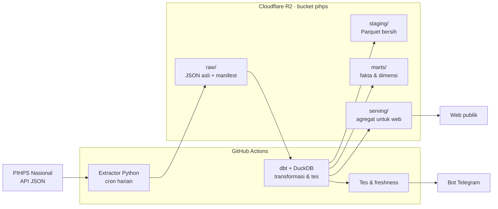

# Rencana Project PIHPS Harga Pangan

_Dokumen hidup. Terakhir diperbarui: 2 Nov 2026 (F2 transformasi). Perbarui bagian **Status** dan **Log keputusan**
setiap kali fase selesai atau keputusan berubah._

## Ringkasan

Pipeline data end-to-end yang mengambil harga pangan harian dari PIHPS Nasional (Bank Indonesia),
menyimpannya di data lake, mengolahnya menjadi model analitik, dan menyajikannya di web yang
mudah dipahami masyarakat awam.

- **Tujuan ganda**: portofolio data engineering (identifikasi → ingestion → storage →
  transformasi → serving → monitoring) sekaligus produk publik yang berguna.
- **Audiens web**: masyarakat umum. Bahasa sederhana, mobile-first, menjawab pertanyaan
  sehari-hari ("harga cabai di kotaku naik atau turun?").
- **Prinsip**: biaya nol (free tier); raw tidak pernah diubah; pipeline idempoten; setiap
  kegagalan terdeteksi; atribusi selalu ke PIHPS Nasional – Bank Indonesia.

## Status

| Fase | Isi | Status |
| --- | --- | --- |
| F0 Fondasi | Repo, endpoint terdokumentasi, probe lolos 18/19 dari runner GitHub, R2 & Telegram siap | Selesai 1 Nov |
| F1 Ingestion harian | Extractor raw + manifest, cron 15.00 WIB, ambil ulang 7 hari | Selesai 1 Nov (PR #1). Run e2e lolos: 685/685 request, 17 menit, 686 objek di R2, Telegram terkirim. Cron harian aktif mulai 2 Nov |
| F2 Transformasi | dbt-duckdb: staging, marts, tes kualitas data | Sedang di-review (branch `claude/adoring-shannon-wtzodk`): proyek `transform/` + `pihps.transform` + workflow `transform` (setelah extract/backfill). Run nyata 2 Nov: 6 manifest, 1.236 file raw, 344 ribu baris staging, 63 node dbt lolos (1 warn), 19 Parquet di R2, Telegram terkirim; run ulang dengan cache: sync 0,4 detik |
| F3 Alert & backfill | Kegagalan senyap, freshness check, backfill bertahap sejak 2017-06-01 | Sedang dikerjakan: workflow backfill siap (uji e2e 2 Nov lolos: 4/4 job, 222 request, 1,54 detik/request), backfill penuh nasional + provinsi berjalan sejak 2 Nov 08.15 WIB ([run 41371527499](https://github.com/hafidznrg/PIHPS/actions/runs/41371527499), ±7 jam); freshness check belum |
| F4 Web visualisasi | Harga hari ini, peta provinsi, tren, perbandingan HET | Belum |
| F5 Analisis & publikasi | Volatilitas, disparitas, musiman, margin rantai pasok; README akhir | Belum |

F1–F3 diprioritaskan selama kredit sesi cloud Claude Code masih ada (habis 5 Nov 2026, 14.59 WIB).

## Arsitektur

Stack: Python 3.12 + uv, httpx, boto3, dbt-duckdb, ruff + pytest di CI.

## Sumber data

Endpoint JSON internal PIHPS (tidak resmi), detail di `docs/api-notes.md`.

| Dimensi | Cakupan | Catatan |
| --- | --- | --- |
| Jenis pasar | 4: Tradisional, Modern, Pedagang Besar, Produsen | `price_type_id` 1–4 terkonfirmasi |
| Komoditas | 10 kategori, 21 komoditas | Satuan menurut API: kg |
| Wilayah | Nasional, 34 provinsi, kab/kota | Level pasar tidak dipublikasikan. Kab/kota per jenis pasar (1 Nov 2026): Tradisional 110, Modern 78, Pedagang Besar 75, Produsen 143 |
| Waktu | Harian (hari kerja), sejak 2017-06-01 | 1 bulan ≈ 1,5 detik; 1 tahun timeout |
| Format | Lebar: kolom per tanggal, harga string `"16,450"` | Diparse ke format panjang |

Catatan: kode wilayah PIHPS ≠ kode BPS (perlu tabel pemetaan; ID kab/kota PIHPS tidak berurutan,
mis. Kota Surakarta = 787); daftar provinsi masih 34; kategori Beras Pasar Modern sama dengan
Tradisional pada sampel probe (perlu dicek).

Temuan run nyata F1 (29–30 Okt 2026, semua jenis pasar & level):

- Jumlah baris per respons **tidak tetap 31**. Komoditas tanpa data tidak muncul sama sekali
  (bukan NULL). Baru 59 dari 110 kab/kota pasar tradisional yang lengkap 31 baris. Staging
  tidak boleh mengasumsikan jumlah baris tetap.
- Produsen: daftar kab/kotanya paling panjang (143), tetapi umumnya hanya memuat 2–10 baris.
  10 kab/kota dan 3 provinsi (DKI Jakarta, Kepulauan Riau, NTT) kosong total. Nasional
  produsen tetap 31 baris, kemungkinan banyak nilai kosong (cek di staging).
- `GetRefRegency` mencantumkan wilayah tanpa data: kosong di Pasar Modern (Kota Surakarta,
  Kota Probolinggo, Kota Maumere) dan di Pedagang Besar (Kab. Aceh Besar, Kota Metro).
- Total respons kosong 18 dari 546 request harga (3,3%; produsen saja 13/178 = 7,3%).

## Desain penyimpanan

| Layer | Lokasi | Format | Isi |
| --- | --- | --- | --- |
| Raw | `raw/pihps/endpoint=…/jenis_pasar=…/ingest_date=…/run_id=…/` | JSON.gz | Respons API apa adanya + snapshot referensi |
| Manifest | `raw/pihps/_manifests/ingest_date=…/run_id=…/_manifest.json` | JSON | URL, params, status HTTP, waktu, sha256, ringkasan run |
| Staging | `staging/stg_pihps__harga/tahun=…/bulan=…/` | Parquet | Format panjang, tipe benar, kode BPS provinsi, dedup *latest wins* |
| Marts | `marts/` | Parquet | `fct_harga_harian/tahun=…/`, `dim_wilayah` (SCD2), `dim_komoditas` (+HET), `dim_pasar`, `dim_tanggal`, `_build.json` |
| Serving | `serving/` | JSON/Parquet kecil | Agregat siap tampil untuk web |

Kunci unik staging: `tanggal × jenis_pasar × kode_wilayah × komoditas_id`. Run harian mengambil
ulang 7 hari terakhir; dedup memilih `_ingested_at` terbaru sehingga revisi BI ikut tertangkap.
`kode_wilayah` = kunci natural PIHPS (`nasional`, `prov-<id>`, `kab-<id>`); kode BPS jadi atribut.
Detail layout raw: `docs/raw-layout.md`; detail model & tes: `transform/README.md`.

## Monitoring & alerting

| Kondisi | Deteksi | Alert |
| --- | --- | --- |
| Workflow gagal / crash | `if: failure()` | Telegram + link run |
| Kegagalan senyap | Nasional pasar tradisional kosong, atau (gagal + kosong) / total request harga > 10% | Run berstatus gagal |
| Data basi | Job freshness: tanggal data terbaru > 3 hari kerja | Peringatan Telegram |
| Cron tidak jalan | Ringkasan harian (selalu dikirim, sukses maupun gagal) tidak masuk | Ketiadaan pesan |
| Kualitas data | dbt tests: unik, not null, relationships, harga raw terparse (error); rentang harga wajar, lonjakan, kelengkapan nasional (warn) | Error: workflow `transform` gagal, publish dibatalkan, Telegram. Warn: tetap publish, jumlah di ringkasan Telegram |

## Risiko & mitigasi

| Risiko | Mitigasi |
| --- | --- |
| Endpoint PIHPS berubah/hilang | Validasi respons + alert; raw lama aman; dokumentasi endpoint |
| BI menambah proteksi bot | User-Agent jujur, jeda 1,5 detik, backoff; cadangan runner di Indonesia |
| Scheduled workflow nonaktif setelah 60 hari tanpa aktivitas repo | Freshness check + ringkasan harian; commit berkala |
| R2 > 10 GB | Raw gzip; dipantau |
| Kredit cloud habis 5 Nov | Kerjakan F1–F3 dulu; sisanya kuota paket |
| Data aneh (Modern = Tradisional, NULL di 2017) | Cek di staging; dokumentasikan keterbatasan di web |

## Keputusan terbuka

- [ ] Backfill kab/kota (45.878 request, ±19–32 jam): kapan dijalankan, dan perlukah daftar kab/kota historis (`GetRefRegency` hanya kondisi sekarang)?
- [ ] Warehouse tambahan untuk query ad-hoc: MotherDuck, BigQuery, atau cukup DuckDB + Parquet di R2?
- [ ] Stack web: Next.js/Astro + ECharts, Evidence.dev, atau DuckDB-WASM di browser?
- [ ] Sumber nilai HET (beras, Minyakita, gula) dan tanggal berlakunya (seed `transform/seeds/het_komoditas.csv` siap, masih kosong)
- [ ] Pemetaan kab/kota PIHPS → kode BPS 4 digit (provinsi sudah; kab/kota butuh seed ±170 baris, pencocokan nama)

## Log keputusan

| Tanggal | Keputusan | Alasan |
| --- | --- | --- |
| 1 Nov 2026 | Lakehouse ringan: R2 + Parquet + dbt-duckdb | Konsep OLAP lengkap, gratis, tidak terkunci vendor |
| 1 Nov 2026 | GitHub Actions sebagai scheduler | Probe membuktikan runner bisa akses PIHPS (HTTP 200, < 1 detik) |
| 1 Nov 2026 | Backfill dipecah per bulan, satu request per wilayah | Rentang 1 tahun timeout; multi-ID mengembalikan rata-rata gabungan |
| 1 Nov 2026 | Manifest di `raw/pihps/_manifests/…`, file nasional `nasional=all.json.gz`, akhiran rentang saat backfill | Satu run mencakup banyak prefix endpoint; potongan bulan tidak saling timpa |
| 1 Nov 2026 | Ringkasan Telegram dikirim setiap run terjadwal | Ketiadaan pesan = sinyal cron tidak jalan |
| 1 Nov 2026 | Cron extract `0 8 * * *` (15.00 WIB), `--notify always` | Data hari itu sudah masuk; ringkasan harian jadi heartbeat |
| 1 Nov 2026 | Silent failure rasio: (gagal + kosong) / request harga > 10%, "kosong" dihitung di level provinsi & kab/kota; nasional pasar tradisional kosong tetap gagal tersendiri | Sesuai rencana monitoring; run nyata 3,3% sehingga ada ruang untuk kekosongan wajar (produsen) |
| 1 Nov 2026 | Kab/kota diminta dengan `province_id` + `regency_id` induknya; daftar kab/kota diambil per jenis pasar per provinsi setiap run | Cakupan beda antar jenis pasar (75–143 kab/kota) |
| 1 Nov 2026 | Respons kosong tetap disimpan ke raw dan dicatat di manifest (`records: 0`) | Bukti audit bahwa sumber memang kosong, bukan gagal ambil |
| 2 Nov 2026 | Backfill level **nasional + provinsi dulu** (15.820 request harga + 120 referensi; terukur 1,54 detik/request → ±7 jam); kab/kota menyusul bertahap | Diputuskan pemilik project; cukup untuk web F4, selesai dalam 1 hari |
| 2 Nov 2026 | Backfill = matriks `jenis_pasar × tahun` (40 job, ±11–18 menit/job), **`max-parallel: 1`**, tradisional & tahun terbaru dulu | Beban ke server tetap 1 request/1,5 detik (risiko proteksi bot); job kecil mudah diulang per bagian; bila terhenti, data paling berguna sudah ada |
| 2 Nov 2026 | Ambang kosong jadi argumen `--max-empty-ratio`: 10% harian, **50% backfill**; ambang terlampaui di backfill = job hijau + warning (data tetap tersimpan) | Tahun awal memang jarang datanya; > 50% kosong tetap terdeteksi sebagai indikasi diblokir |
| 2 Nov 2026 | Circuit breaker: run berhenti setelah 10 kegagalan beruntun (exit 3); di backfill, exit 3 membatalkan job sisanya (fail-fast) | Saat diblokir/server mati, tidak terus mengirim ratusan request × retry |
| 2 Nov 2026 | Backfill dibiarkan tumpang-tindih dengan cron harian 08:00 UTC (maks. 2 client ±20 menit) | `concurrency` GitHub hanya menyimpan 1 run tertunda per grup, sehingga berbagi grup bisa membatalkan job matriks |
| 2 Nov 2026 | Transformasi = sync raw R2 → disk runner **lewat manifest** (inkremental, di-cache Actions), lalu `dbt build` penuh di DuckDB, lalu publish Parquet ke R2 | Tes dbt deterministik di CI tanpa R2; tidak bergantung httpfs/S3 untuk ribuan file kecil; run harian hanya mengunduh file baru |
| 2 Nov 2026 | Staging membaca raw dengan glob + *inner join* ke manifest (`ok = true`); respons harga tanpa record tidak diunduh | Manifest sumber kebenaran; file yatim dari run crash tersaring |
| 2 Nov 2026 | Dedup *latest wins* berdasarkan `fetched_at` manifest, termasuk nilai kosong terbaru | Staging = versi terakhir BI; revisi tertangkap; `stg_pihps__harga_raw` menyimpan semua versi untuk audit |
| 2 Nov 2026 | `kode_wilayah` = kunci natural PIHPS (`prov-13`, `kab-787`); kode BPS provinsi dari seed sebagai atribut | ID PIHPS ≠ BPS dan kab/kota belum terpetakan; kunci harus selalu ada |
| 2 Nov 2026 | `dim_wilayah` SCD2 diturunkan ulang dari semua snapshot referensi di raw (bukan `dbt snapshot`); versi pertama berlaku sejak 2017-06-01 | Raw immutable = histori lengkap, tanpa state yang bisa hilang; fakta backfill tetap tergabung |
| 2 Nov 2026 | Publish = unggah dulu, lalu hapus objek basi di `staging/` & `marts/`; hanya bila tidak ada tes `error` | Isi R2 selalu = build terakhir yang lolos; pembaca tidak pernah melihat prefix kosong |
| 2 Nov 2026 | Workflow `transform` dipicu `workflow_run` setelah `extract`/`backfill` (kecuali dibatalkan), Telegram setiap run | Data berhasil sebagian tetap diolah; ringkasan jadi heartbeat kedua |
