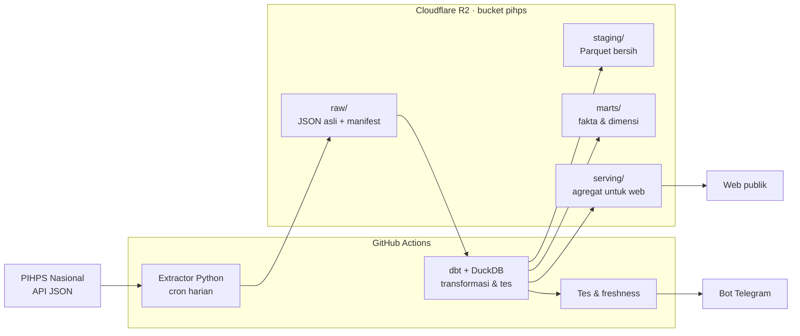

# Rencana Project PIHPS Harga Pangan

_Dokumen hidup. Terakhir diperbarui: 5 Nov 2026 (backfill kab/kota selesai, transform OOM diperbaiki). Perbarui bagian **Status** dan **Log keputusan**
setiap kali fase selesai atau keputusan berubah._

## Ringkasan

Pipeline data end-to-end yang mengambil harga pangan harian dari PIHPS Nasional (Bank Indonesia),
menyimpannya di data lake, mengolahnya menjadi model analitik, dan menyajikannya di web yang
mudah dipahami masyarakat awam.

- **Tujuan ganda**: portofolio data engineering (identifikasi → ingestion → storage →
  transformasi → serving → monitoring) sekaligus produk publik yang berguna.
- **Audiens web**: masyarakat umum. Bahasa sederhana, mobile-first, menjawab pertanyaan
  sehari-hari ("harga cabai di kotaku naik atau turun?").
- **Prinsip**: biaya nol (free tier); raw tidak pernah diubah; pipeline idempoten; setiap
  kegagalan terdeteksi; atribusi selalu ke PIHPS Nasional – Bank Indonesia.

## Status

| Fase | Isi | Status |
| --- | --- | --- |
| F0 Fondasi | Repo, endpoint terdokumentasi, probe lolos 18/19 dari runner GitHub, R2 & Telegram siap | Selesai 1 Nov |
| F1 Ingestion harian | Extractor raw + manifest, cron 10.23 WIB (ringan) + 15.23 WIB (penuh), ambil ulang 7 hari | Selesai 1 Nov (PR #1). Run e2e lolos: 685/685 request, 17 menit, 686 objek di R2, Telegram terkirim. Cron harian terbukti jalan: run terjadwal pertama 2 Nov ([run 41492692040](https://github.com/hafidznrg/PIHPS/actions/runs/41492692040)) lolos 685/685 request, 13.026 record, Telegram terkirim, lalu `transform` → `web` otomatis hijau — tetapi terpicu 17.36 UTC, ±9,5 jam setelah jadwal 08.00 UTC; sejak 3 Nov dua jadwal (lihat Log keputusan) |
| F2 Transformasi | dbt-duckdb: staging, marts, tes kualitas data | Selesai 2 Nov (PR #3). Data penuh: 8,74 juta baris staging 2017-06-01 → 2026-10-30, 203 wilayah; dbt 130 detik; 196 sel outlier ditandai; Parquet + 239 file serving di R2; Telegram terkirim |
| F3 Alert & backfill | Kegagalan senyap, freshness check, backfill bertahap sejak 2017-06-01 | Selesai 2 Nov untuk nasional + provinsi: backfill 40/40 job, 15.940 request, 0 gagal, 403.985 record, 8,2 jam ([run 41371527499](https://github.com/hafidznrg/PIHPS/actions/runs/41371527499)); workflow `freshness` harian (PR #3). Backfill kab/kota selesai 4 Nov 05.27 UTC ([run 41599876428](https://github.com/hafidznrg/PIHPS/actions/runs/41599876428)): 40/40 job jalan, 47.358 request, 2 gagal (produsen 2017), 7.366 kosong, 883.179 record, 460,5 MB mentah, 21,3 jam, daftar kab/kota kondisi sekarang. Transform sesudahnya OOM (12,4/12,4 GiB) sampai diperbaiki 5 Nov (lihat Log keputusan); run uji dari branch ([run 41944489711](https://github.com/hafidznrg/PIHPS/actions/runs/41944489711)) lolos: 27,8 juta baris staging, 205 wilayah, dbt 243 detik |
| F4 Web visualisasi | Harga hari ini, peta provinsi, tren, perbandingan HET | Selesai 2 Nov (PR #3): tayang di <https://hafidznrg.github.io/PIHPS/>; deploy pertama dari `main` sukses (240 halaman, kontrak & 14 e2e data nyata lolos). 3 Nov: perbaikan kecepatan, beranda berhierarki insight, dan peta SVG tanpa distorsi (PR branch `claude/magical-wright-nuumv7`). Berikutnya: HET (menunggu sumber nilai) |
| F5 Analisis & publikasi | Volatilitas, disparitas, musiman, margin rantai pasok; README akhir | Belum |

Kondisi operasional per 5 Nov 2026: `extract` harian dan `freshness` hijau. `transform` di `main`
gagal OOM sejak data kab/kota masuk (3 run, 4 Nov) sehingga R2 & web tertahan di build 3 Nov
(data s.d. 3 Nov) sampai PR perbaikan memori di-merge; setelah merge, run `transform` berikutnya
memperbarui R2 dan web. Sebelumnya rantai harian `extract` → `transform` → `web` berjalan hijau. Run terjadwal GitHub Actions terlambat ±9,5–10 jam (extract 17.36 UTC,
freshness 20.30 UTC pada 2 Nov), sehingga data di web baru diperbarui sekitar 00.30–01.00 WIB hari
berikutnya. Mitigasi sejak 3 Nov: run pagi ringan (nasional + provinsi) ditambah run sore penuh.

F1–F3 diprioritaskan selama kredit sesi cloud Claude Code masih ada (habis 5 Nov 2026, 14.59 WIB).

## Arsitektur

Stack: Python 3.12 + uv, httpx, boto3, dbt-duckdb, ruff + pytest di CI.

## Sumber data

Endpoint JSON internal PIHPS (tidak resmi), detail di `docs/api-notes.md`.

| Dimensi | Cakupan | Catatan |
| --- | --- | --- |
| Jenis pasar | 4: Tradisional, Modern, Pedagang Besar, Produsen | `price_type_id` 1–4 terkonfirmasi |
| Komoditas | 10 kategori, 21 komoditas | Satuan menurut API: kg |
| Wilayah | Nasional, 34 provinsi, kab/kota | Level pasar tidak dipublikasikan. Kab/kota per jenis pasar (1 Nov 2026): Tradisional 110, Modern 78, Pedagang Besar 75, Produsen 143 |
| Waktu | Harian (hari kerja), sejak 2017-06-01 | 1 bulan ≈ 1,5 detik; 1 tahun timeout |
| Format | Lebar: kolom per tanggal, harga string `"16,450"` | Diparse ke format panjang |

Catatan: kode wilayah PIHPS ≠ kode BPS (dipetakan lewat seed `wilayah_provinsi_bps` dan
`wilayah_kabkota_bps`; ID kab/kota PIHPS tidak berurutan, dan Kota Surakarta punya dua id: 36 dan 787); daftar provinsi masih 34; kategori Beras Pasar Modern sama dengan
Tradisional pada sampel probe (perlu dicek).

Temuan run nyata F1 (29–30 Okt 2026, semua jenis pasar & level):

- Jumlah baris per respons **tidak tetap 31**. Komoditas tanpa data tidak muncul sama sekali
  (bukan NULL). Baru 59 dari 110 kab/kota pasar tradisional yang lengkap 31 baris. Staging
  tidak boleh mengasumsikan jumlah baris tetap.
- Produsen: daftar kab/kotanya paling panjang (143), tetapi umumnya hanya memuat 2–10 baris.
  10 kab/kota dan 3 provinsi (DKI Jakarta, Kepulauan Riau, NTT) kosong total. Nasional
  produsen tetap 31 baris, kemungkinan banyak nilai kosong (cek di staging).
- `GetRefRegency` mencantumkan wilayah tanpa data: kosong di Pasar Modern (Kota Surakarta,
  Kota Probolinggo, Kota Maumere) dan di Pedagang Besar (Kab. Aceh Besar, Kota Metro).
- Total respons kosong 18 dari 546 request harga (3,3%; produsen saja 13/178 = 7,3%).

Temuan backfill (2 Nov): respons kosong per jenis pasar tradisional 20, modern 531, pedagang besar
31, produsen 633 dari 3.985 request masing-masing. Tiga job melewati ambang kosong 50% (job tetap
hijau, data tersimpan): pasar modern 2018 (51%), produsen 2018 (60%), produsen 2017 (97%) — data
produsen praktis baru ada sejak 2019, pasar modern jarang sebelum 2019.

Temuan backfill kab/kota (4 Nov): respons kosong tradisional 1.094, modern 2.124, pedagang besar
738, produsen 3.410. Lima job melewati ambang kosong 50%: pasar modern 2017 (59,5%), 2018
(58,7%), 2019 (52,7%), produsen 2018 (68,4%), produsen 2017 (100%, termasuk 2 request gagal).
Pola sama dengan level provinsi. Hasil staging penuh (5 Nov, nasional + provinsi + kab/kota):
27,8 juta baris (27,0 juta berharga), 205 wilayah di data (dim_wilayah 206: 171 kab/kota, 34
provinsi, nasional); baris per jenis pasar: tradisional 9,99 juta (145 wilayah), modern 5,93 juta
(113), pedagang besar 7,45 juta (108, mulai 2017-06-08), produsen 4,44 juta (175, mulai
2018-03-26). 13.492 sel direvisi; 695 sel outlier ditandai (≤ 0,004%); tes warn: 289 sel di
luar rentang wajar (terbesar produsen com_9 Rp12 juta, prov-7 dan kab-17, Sep 2021) dan 1.630
lonjakan harian > 3× (1.046 di produsen). Serving 241 file, 20,3 MB (sebelumnya 16,0 MB).

Temuan F2 (staging penuh pasar tradisional 2017–2026, 3,15 juta baris):

- PIHPS terbit setiap Senin–Jumat, **termasuk libur nasional & cuti bersama** (mis. 24 hari libur
  di 2025 tetap ada data), tidak pernah di akhir pekan. Apakah nilai hari libur hasil
  *carry-forward* perlu dicek di F5. Freshness tetap mengecualikan libur (lebih toleran).
- Sel kosong nasional pasar tradisional: 2017 3,3%, 2018–2022 0,4–2,4%, 0 sejak 2023.
- Salah input di sumber (tertangkap tes warn): Bengkulu Juni 2017 beras Rp100 & ayam Rp1.100;
  salah digit (×10) mis. beras pasar modern Sumsel 139.000 → 13.900 (Feb 2025), daging sapi
  pasar modern Kalteng 14.800 ↔ 147.900 (Jul 2025), minyak curah Papua Barat 11.500 ↔ 65.500
  (Nov 2019). Dibiarkan di staging (raw apa adanya); penanganan outlier untuk web di F4/F5.
- Pasar modern identik dengan tradisional hanya 0,84% sel (3.934/470.795).
- PIHPS punya dua id untuk Kota Surakarta (36 "Kota Surakarta (Solo)" dan 787).

## Desain penyimpanan

| Layer | Lokasi | Format | Isi |
| --- | --- | --- | --- |
| Raw | `raw/pihps/endpoint=…/jenis_pasar=…/ingest_date=…/run_id=…/` | JSON.gz | Respons API apa adanya + snapshot referensi |
| Manifest | `raw/pihps/_manifests/ingest_date=…/run_id=…/_manifest.json` | JSON | URL, params, status HTTP, waktu, sha256, ringkasan run |
| Staging | `staging/stg_pihps__harga/tahun=…/bulan=…/` | Parquet | Format panjang, tipe benar, kode BPS provinsi, dedup *latest wins* |
| Marts | `marts/` | Parquet | `fct_harga_harian/tahun=…/`, `dim_wilayah` (SCD2), `dim_komoditas` (+HET), `dim_pasar`, `dim_tanggal`, `_build.json` |
| Serving | `serving/` | JSON kecil berkontrak (JSON Schema + batas ukuran) | `meta.json`, `wilayah/<kode>.json`, `peta/<jenis_pasar>.json`, `tren/<komoditas>.json`; dibangun model dbt `srv_*`, ditulis `pihps.serving` |

Kunci unik staging: `tanggal × jenis_pasar × kode_wilayah × komoditas_id`. Run harian mengambil
ulang 7 hari terakhir; dedup memilih `_ingested_at` terbaru sehingga revisi BI ikut tertangkap.
`kode_wilayah` = kunci natural PIHPS (`nasional`, `prov-<id>`, `kab-<id>`); kode BPS jadi atribut.
Detail layout raw: `docs/raw-layout.md`; detail model & tes: `transform/README.md`.

## Monitoring & alerting

| Kondisi | Deteksi | Alert |
| --- | --- | --- |
| Workflow gagal / crash | `if: failure()` | Telegram + link run |
| Kegagalan senyap | Nasional pasar tradisional kosong, atau (gagal + kosong) / total request harga > 10% | Run berstatus gagal |
| Data basi | Workflow `freshness` (17.47 WIB): harga nasional pasar tradisional terbaru > 3 hari kerja (di luar libur nasional & cuti bersama), atau `marts/_build.json` > 30 jam | Run gagal + Telegram |
| Cron tidak jalan | Ringkasan harian (selalu dikirim, sukses maupun gagal) tidak masuk | Ketiadaan pesan |
| Kualitas data | dbt tests: unik, not null, relationships, harga raw terparse (error); rentang harga wajar, lonjakan, kelengkapan nasional (warn) | Error: workflow `transform` gagal, publish dibatalkan, Telegram. Warn: tetap publish, jumlah di ringkasan Telegram |

## Web (F4)

- **Stack**: Astro (situs statis) + ECharts. Data halaman = JSON serving yang dibuat dbt saat
  transform, disalin ke situs saat build; tidak ada server atau API.
- **Serving layer = kontrak data**: model `srv_*` (logika & tes di dbt) → `pihps.serving` menulis
  JSON dengan nama file tetap, divalidasi JSON Schema dan batas ukuran per file. Web hanya
  bergantung pada kontrak ini, bukan pada tabel marts.
- **Outlier**: `fct_harga_harian.is_outlier` menandai salah input (median bergulir per seri);
  marts tetap setia ke sumber, serving memakai sel bersih.
- **Halaman**: Beranda (harga hari ini nasional, naik/turun), Wilayah (provinsi & kab/kota),
  Peta provinsi, Komoditas (tren sejak 2017 + rantai pasok produsen → pedagang besar → eceran),
  Jelajahi (DuckDB-WASM membaca Parquet marts dari origin yang sama), Tentang data.
- **Kinerja**: peta provinsi = SVG yang diproyeksikan & disederhanakan saat build
  (`web/src/lib/geo.ts`), bukan ECharts + GeoJSON di peramban; keempat jenis pasar dirender
  saat build; grafik memakai file *view* build-time (`/data/view/wilayah/<kode>/{harian,bulanan}.json`)
  yang diturunkan dari kontrak serving, jadi kontrak & pipeline tidak berubah. ECharts hanya
  dimuat saat grafik hampir terlihat.
- **Beranda**: hierarki fokus = (1) judul insight perubahan mingguan terbesar + hitungan
  naik/turun/stabil, (2) kartu sorotan, (3) papan semua komoditas, lalu grafik & catatan.
- **Peta**: warna diverging terhadap rata-rata nasional, 5 kelas berambang tetap (±5%, ±15%).
- **Hosting**: GitHub Pages lewat Actions (repo publik, tanpa secret tambahan). Workflow `web`
  berjalan setelah `transform`.

## Risiko & mitigasi

| Risiko | Mitigasi |
| --- | --- |
| Endpoint PIHPS berubah/hilang | Validasi respons + alert; raw lama aman; dokumentasi endpoint |
| BI menambah proteksi bot | User-Agent jujur, jeda 1,5 detik, backoff; cadangan runner di Indonesia |
| Scheduled workflow nonaktif setelah 60 hari tanpa aktivitas repo | Freshness check + ringkasan harian; commit berkala |
| R2 > 10 GB | Raw gzip; dipantau |
| Jadwal GitHub Actions terlambat berjam-jam (terukur ±9,5 jam, 2 Nov) | Dua jadwal extract (pagi ringan, sore penuh) di menit bukan :00; freshness bertoleransi 3 hari kerja & 30 jam; Telegram run sore jadi heartbeat; opsi scheduler eksternal |
| Kredit cloud habis 5 Nov | Kerjakan F1–F3 dulu; sisanya kuota paket |
| Data aneh (Modern = Tradisional, NULL di 2017) | Cek di staging; dokumentasikan keterbatasan di web |

## Keputusan terbuka

- [x] ~~Backfill kab/kota: kapan, dan perlukah daftar historis?~~ — diputuskan 3 Nov: jalan sekarang dengan daftar kondisi sekarang (lihat Log keputusan)
- [ ] Warehouse tambahan untuk query ad-hoc: MotherDuck, BigQuery, atau cukup DuckDB + Parquet di R2?
- [x] ~~Cron `extract` belum pernah terpicu~~ — terjawab 3 Nov: cron 2 Nov terpicu, hanya terlambat ±9,5 jam (lihat Log keputusan)
- [ ] Keterlambatan cron: pantau seminggu dengan dua jadwal. Bila tetap terlambat > 6 jam setiap hari, pindah ke scheduler eksternal (`workflow_dispatch` dari cron-job.org/Cloudflare Worker, perlu token GitHub sebagai secret)
- [ ] Sumber nilai HET (beras, Minyakita, gula) dan tanggal berlakunya (seed `transform/seeds/het_komoditas.csv` siap, masih kosong)

## Log keputusan

| Tanggal | Keputusan | Alasan |
| --- | --- | --- |
| 1 Nov 2026 | Lakehouse ringan: R2 + Parquet + dbt-duckdb | Konsep OLAP lengkap, gratis, tidak terkunci vendor |
| 1 Nov 2026 | GitHub Actions sebagai scheduler | Probe membuktikan runner bisa akses PIHPS (HTTP 200, < 1 detik) |
| 1 Nov 2026 | Backfill dipecah per bulan, satu request per wilayah | Rentang 1 tahun timeout; multi-ID mengembalikan rata-rata gabungan |
| 1 Nov 2026 | Manifest di `raw/pihps/_manifests/…`, file nasional `nasional=all.json.gz`, akhiran rentang saat backfill | Satu run mencakup banyak prefix endpoint; potongan bulan tidak saling timpa |
| 1 Nov 2026 | Ringkasan Telegram dikirim setiap run terjadwal | Ketiadaan pesan = sinyal cron tidak jalan |
| 1 Nov 2026 | Cron extract `0 8 * * *` (15.00 WIB), `--notify always` | Data hari itu sudah masuk; ringkasan harian jadi heartbeat |
| 1 Nov 2026 | Silent failure rasio: (gagal + kosong) / request harga > 10%, "kosong" dihitung di level provinsi & kab/kota; nasional pasar tradisional kosong tetap gagal tersendiri | Sesuai rencana monitoring; run nyata 3,3% sehingga ada ruang untuk kekosongan wajar (produsen) |
| 1 Nov 2026 | Kab/kota diminta dengan `province_id` + `regency_id` induknya; daftar kab/kota diambil per jenis pasar per provinsi setiap run | Cakupan beda antar jenis pasar (75–143 kab/kota) |
| 1 Nov 2026 | Respons kosong tetap disimpan ke raw dan dicatat di manifest (`records: 0`) | Bukti audit bahwa sumber memang kosong, bukan gagal ambil |
| 2 Nov 2026 | Backfill level **nasional + provinsi dulu** (15.820 request harga + 120 referensi; terukur 1,54 detik/request → ±7 jam); kab/kota menyusul bertahap | Diputuskan pemilik project; cukup untuk web F4, selesai dalam 1 hari |
| 2 Nov 2026 | Backfill = matriks `jenis_pasar × tahun` (40 job, ±11–18 menit/job), **`max-parallel: 1`**, tradisional & tahun terbaru dulu | Beban ke server tetap 1 request/1,5 detik (risiko proteksi bot); job kecil mudah diulang per bagian; bila terhenti, data paling berguna sudah ada |
| 2 Nov 2026 | Ambang kosong jadi argumen `--max-empty-ratio`: 10% harian, **50% backfill**; ambang terlampaui di backfill = job hijau + warning (data tetap tersimpan) | Tahun awal memang jarang datanya; > 50% kosong tetap terdeteksi sebagai indikasi diblokir |
| 2 Nov 2026 | Circuit breaker: run berhenti setelah 10 kegagalan beruntun (exit 3); di backfill, exit 3 membatalkan job sisanya (fail-fast) | Saat diblokir/server mati, tidak terus mengirim ratusan request × retry |
| 2 Nov 2026 | Backfill dibiarkan tumpang-tindih dengan cron harian 08:00 UTC (maks. 2 client ±20 menit) | `concurrency` GitHub hanya menyimpan 1 run tertunda per grup, sehingga berbagi grup bisa membatalkan job matriks |
| 2 Nov 2026 | Transformasi = sync raw R2 → disk runner **lewat manifest** (inkremental, di-cache Actions), lalu `dbt build` penuh di DuckDB, lalu publish Parquet ke R2 | Tes dbt deterministik di CI tanpa R2; tidak bergantung httpfs/S3 untuk ribuan file kecil; run harian hanya mengunduh file baru |
| 2 Nov 2026 | Staging membaca raw dengan glob + *inner join* ke manifest (`ok = true`); respons harga tanpa record tidak diunduh | Manifest sumber kebenaran; file yatim dari run crash tersaring |
| 2 Nov 2026 | Dedup *latest wins* berdasarkan `fetched_at` manifest, termasuk nilai kosong terbaru | Staging = versi terakhir BI; revisi tertangkap; `stg_pihps__harga_raw` menyimpan semua versi untuk audit |
| 2 Nov 2026 | `kode_wilayah` = kunci natural PIHPS (`prov-13`, `kab-787`); kode BPS provinsi dari seed sebagai atribut | ID PIHPS ≠ BPS dan kab/kota belum terpetakan; kunci harus selalu ada |
| 2 Nov 2026 | `dim_wilayah` SCD2 diturunkan ulang dari semua snapshot referensi di raw (bukan `dbt snapshot`); versi pertama berlaku sejak 2017-06-01 | Raw immutable = histori lengkap, tanpa state yang bisa hilang; fakta backfill tetap tergabung |
| 2 Nov 2026 | Publish = unggah dulu, lalu hapus objek basi di `staging/` & `marts/`; hanya bila tidak ada tes `error` | Isi R2 selalu = build terakhir yang lolos; pembaca tidak pernah melihat prefix kosong |
| 2 Nov 2026 | Workflow `transform` dipicu `workflow_run` setelah `extract`/`backfill` (kecuali dibatalkan), Telegram setiap run | Data berhasil sebagian tetap diolah; ringkasan jadi heartbeat kedua |
| 2 Nov 2026 | Freshness membaca `marts/_build.json` (bukan raw) | Sekaligus mendeteksi transform yang berhenti |
| 2 Nov 2026 | Kalender libur = seed `hari_libur` (libur nasional + cuti bersama 2017–2027) dibangkitkan `scripts/gen_hari_libur.py` dari paket `holidays`, bukan dependency pipeline | Hari kerja yang benar untuk freshness (tanpa alarm palsu Lebaran) dan `dim_tanggal.is_hari_kerja` untuk analisis F5; diperbarui saat SKB tahun baru terbit |
| 2 Nov 2026 | Kab/kota PIHPS → kode BPS 4 digit lewat seed `wilayah_kabkota_bps` dari MFD BPS Jan 2018 (34 provinsi): 148 otomatis, 23 manual; kab/kota baru tanpa pemetaan = warn | Cakupan provinsi PIHPS masih pra-pemekaran; "Kota X" PIHPS kadang kota pasar = ibu kota kabupaten (Sampit, Tembilahan, Watampone, …) |
| 2 Nov 2026 | Web F4 = Astro + ECharts + serving layer dbt, + satu halaman Jelajahi berbasis DuckDB-WASM | Diputuskan pemilik project: cepat di HP untuk publik; nilai portofolio ada di serving layer sebagai kontrak data; DuckDB-WASM menunjukkan lakehouse bisa di-query tanpa server |
| 2 Nov 2026 | Serving ditulis Python dari model dbt (bukan COPY JSON DuckDB); format kolumnar ringkas (array tanggal bersama + array harga) | Nama file per wilayah/komoditas tetap dan struktur bersarang; ukuran kecil untuk HP |
| 2 Nov 2026 | Hosting GitHub Pages; Parquet marts ikut disajikan dari origin situs untuk halaman Jelajahi | Tanpa bucket R2 publik/CORS dan tanpa secret baru; pembacaan Parquet via HTTP range |
| 2 Nov 2026 | Outlier juga = harga > Rp1 juta/kg | Salah input berkepanjangan (Bengkulu produsen daging sapi Rp12 juta/kg sebulan) mencemari median jendela sehingga aturan relatif saja tidak cukup |
| 2 Nov 2026 | Workflow produksi memasang dependency minimum: extract/backfill/probe/freshness `--no-default-groups`, transform/web `--group transform`; grup `dev` (+`transform`) tetap default untuk lokal & CI | Run harian tidak perlu dbt/duckdb/pytest; lebih cepat dan permukaan dependency lebih kecil |
| 3 Nov 2026 | Cron extract jadi dua jadwal: `23 3 * * *` (10.23 WIB) nasional + provinsi saja, Telegram hanya bila gagal; `23 8 * * *` (15.23 WIB) penuh, Telegram selalu. Jenis run dibedakan lewat `github.event.schedule` | Run terjadwal 2 Nov terlambat ±9,5 jam. Run pagi membuat angka utama web tetap tayang hari itu walau terlambat; tambahan beban ke PIHPS ±180 request/hari (bukan 685); run sore tetap jadi heartbeat. Menit :23 menghindari puncak antrean jadwal GitHub di :00. Scheduler eksternal ditunda karena butuh secret baru |
| 3 Nov 2026 | Peta = SVG build-time; skala diverging vs rata-rata nasional, kelas tetap ±5%/±15% (biru murah, abu setara, merah mahal), bukan gradasi kontinu min–max | Diputuskan pemilik project. Peta lama terdistorsi (ECharts merentang ke kotak wadah) dan butuh ±900 KB JS+GeoJSON. Ambang tetap membuat arti warna sama di semua komoditas dan memisahkan "mencolok sekali" dari "sedikit"; pola diverging dengan titik tengah netral pada rata-rata mengikuti praktik Datawrapper/Esri untuk cerita di atas–di bawah rata-rata |
| 3 Nov 2026 | Optimasi web tanpa mengubah kontrak serving: panel 4 jenis pasar dirender saat build, file view grafik dibuat saat build, font Newsreader sumbu `wght` + preload | Kontrak serving tetap stabil bagi pipeline; penghematan terbesar ada di sisi situs. Dievaluasi lagi bila wilayah/<kode>.json perlu dipecah di serving |
| 3 Nov 2026 | Backfill kab/kota dijalankan dengan daftar `GetRefRegency` kondisi sekarang: workflow `backfill` yang ada, `levels=kabkota`, 2017-06-01 → 2026-10-31, matriks 40 job, `max-parallel: 1` | Diputuskan pemilik project. Tanpa perubahan kode; kab/kota yang sudah hilang dari daftar PIHPS tidak terambil (keterbatasan didokumentasikan). Kapasitas cukup: transform 3,5 dari 60 menit, situs 14,7 MB |
| 5 Nov 2026 | DuckDB dibatasi di `profiles.yml`: `memory_limit` 8GB (env `PIHPS_DUCKDB_MEMORY_LIMIT`), `preserve_insertion_order: false`; `stg_pihps__manifest_files` & `stg_pihps__harga_raw` jadi tabel (JSON di-parse sekali) | Transform OOM setelah kab/kota masuk. Direproduksi dengan raw sintetis seukuran produksi (38 juta baris): RSS puncak 11,8 GB pada batas default. Sesudah perbaikan, dengan batas 5 GB: RSS 5,4 GB, 404 detik (data 1×) dan 897 detik (data 2×, 67 juta baris), jadi ada ruang tumbuh. Di Actions dengan data nyata: dbt 243 detik (sebelumnya gagal setelah ±5,5 menit) |
| 5 Nov 2026 | Summary backfill: job yang hanya melewati ambang kosong (tanpa request gagal, tanpa circuit breaker, tanpa silent failure lain) = sukses dengan peringatan ⚠️ | Konsisten dengan keputusan 2 Nov (data tahun awal memang jarang); sebelumnya summary selalu merah (37/40, 35/40) walau semua respons tersimpan. Request gagal tetap membuat summary gagal |
