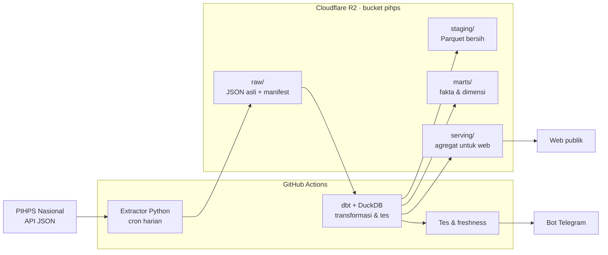

# Rencana Project PIHPS Harga Pangan

_Dokumen hidup. Terakhir diperbarui: 1 Nov 2026. Perbarui bagian **Status** dan **Log keputusan**
setiap kali fase selesai atau keputusan berubah._

## Ringkasan

Pipeline data end-to-end yang mengambil harga pangan harian dari PIHPS Nasional (Bank Indonesia),
menyimpannya di data lake, mengolahnya menjadi model analitik, dan menyajikannya di web yang
mudah dipahami masyarakat awam.

- **Tujuan ganda**: portofolio data engineering (identifikasi → ingestion → storage →
  transformasi → serving → monitoring) sekaligus produk publik yang berguna.
- **Audiens web**: masyarakat umum. Bahasa sederhana, mobile-first, menjawab pertanyaan
  sehari-hari ("harga cabai di kotaku naik atau turun?").
- **Prinsip**: biaya nol (free tier); raw tidak pernah diubah; pipeline idempoten; setiap
  kegagalan terdeteksi; atribusi selalu ke PIHPS Nasional – Bank Indonesia.

## Status

| Fase | Isi | Status |
| --- | --- | --- |
| F0 Fondasi | Repo, endpoint terdokumentasi, probe lolos 18/19 dari runner GitHub, R2 & Telegram siap | Selesai 1 Nov |
| F1 Ingestion harian | Extractor raw + manifest, cron 15.00 WIB, ambil ulang 7 hari | Sedang dikerjakan (branch `claude/pihps-phase-1-extractor-*`, belum ada PR) |
| F2 Transformasi | dbt-duckdb: staging, marts, tes kualitas data | Belum |
| F3 Alert & backfill | Kegagalan senyap, freshness check, backfill bertahap sejak 2017-06-01 | Belum |
| F4 Web visualisasi | Harga hari ini, peta provinsi, tren, perbandingan HET | Belum |
| F5 Analisis & publikasi | Volatilitas, disparitas, musiman, margin rantai pasok; README akhir | Belum |

F1–F3 diprioritaskan selama kredit sesi cloud Claude Code masih ada (habis 5 Nov 2026, 14.59 WIB).

## Arsitektur

Stack: Python 3.12 + uv, httpx, boto3, dbt-duckdb, ruff + pytest di CI.

## Sumber data

Endpoint JSON internal PIHPS (tidak resmi), detail di `docs/api-notes.md`.

| Dimensi | Cakupan | Catatan |
| --- | --- | --- |
| Jenis pasar | 4: Tradisional, Modern, Pedagang Besar, Produsen | `price_type_id` 1–4 terkonfirmasi |
| Komoditas | 10 kategori, 21 komoditas | Satuan menurut API: kg |
| Wilayah | Nasional, 34 provinsi, kab/kota | Level pasar tidak dipublikasikan |
| Waktu | Harian (hari kerja), sejak 2017-06-01 | 1 bulan ≈ 1,5 detik; 1 tahun timeout |
| Format | Lebar: kolom per tanggal, harga string `"16,450"` | Diparse ke format panjang |

Catatan: kode wilayah PIHPS ≠ kode BPS (perlu tabel pemetaan); daftar provinsi masih 34;
kategori Beras Pasar Modern sama dengan Tradisional pada sampel probe (perlu dicek).

## Desain penyimpanan

| Layer | Lokasi | Format | Isi |
| --- | --- | --- | --- |
| Raw | `raw/pihps/endpoint=…/jenis_pasar=…/ingest_date=…/run_id=…/` | JSON.gz | Respons API apa adanya + snapshot referensi |
| Manifest | `raw/pihps/_manifests/ingest_date=…/run_id=…/_manifest.json` | JSON | URL, params, status HTTP, waktu, sha256, ringkasan run |
| Staging | `staging/stg_pihps__harga/tahun=…/bulan=…/` | Parquet | Format panjang, tipe benar, kode BPS, dedup *latest wins* |
| Marts | `marts/` | Parquet | `fct_harga_harian`, `dim_wilayah` (SCD2), `dim_komoditas` (+HET), `dim_pasar`, `dim_tanggal` |
| Serving | `serving/` | JSON/Parquet kecil | Agregat siap tampil untuk web |

Kunci unik staging: `tanggal × jenis_pasar × kode_wilayah × komoditas_id`. Run harian mengambil
ulang 7 hari terakhir; dedup memilih `_ingested_at` terbaru sehingga revisi BI ikut tertangkap.
Detail layout raw: `docs/raw-layout.md`.

## Monitoring & alerting

| Kondisi | Deteksi | Alert |
| --- | --- | --- |
| Workflow gagal / crash | `if: failure()` | Telegram + link run |
| Kegagalan senyap | Nasional pasar tradisional kosong, atau (gagal + kosong) / total request harga > 10% | Run berstatus gagal |
| Data basi | Job freshness: tanggal data terbaru > 3 hari kerja | Peringatan Telegram |
| Cron tidak jalan | Ringkasan harian (selalu dikirim, sukses maupun gagal) tidak masuk | Ketiadaan pesan |
| Kualitas data | dbt tests: not null, unique, rentang harga wajar | Gagal di step transformasi |

## Risiko & mitigasi

| Risiko | Mitigasi |
| --- | --- |
| Endpoint PIHPS berubah/hilang | Validasi respons + alert; raw lama aman; dokumentasi endpoint |
| BI menambah proteksi bot | User-Agent jujur, jeda 1,5 detik, backoff; cadangan runner di Indonesia |
| Scheduled workflow nonaktif setelah 60 hari tanpa aktivitas repo | Freshness check + ringkasan harian; commit berkala |
| R2 > 10 GB | Raw gzip; dipantau |
| Kredit cloud habis 5 Nov | Kerjakan F1–F3 dulu; sisanya kuota paket |
| Data aneh (Modern = Tradisional, NULL di 2017) | Cek di staging; dokumentasikan keterbatasan di web |

## Keputusan terbuka

- [ ] Level wilayah untuk backfill: nasional + provinsi dulu, atau langsung kab/kota?
- [ ] Warehouse tambahan untuk query ad-hoc: MotherDuck, BigQuery, atau cukup DuckDB + Parquet di R2?
- [ ] Stack web: Next.js/Astro + ECharts, Evidence.dev, atau DuckDB-WASM di browser?
- [ ] Sumber nilai HET (beras, Minyakita, gula) dan tanggal berlakunya

## Log keputusan

| Tanggal | Keputusan | Alasan |
| --- | --- | --- |
| 1 Nov 2026 | Lakehouse ringan: R2 + Parquet + dbt-duckdb | Konsep OLAP lengkap, gratis, tidak terkunci vendor |
| 1 Nov 2026 | GitHub Actions sebagai scheduler | Probe membuktikan runner bisa akses PIHPS (HTTP 200, < 1 detik) |
| 1 Nov 2026 | Backfill dipecah per bulan, satu request per wilayah | Rentang 1 tahun timeout; multi-ID mengembalikan rata-rata gabungan |
| 1 Nov 2026 | Manifest di `raw/pihps/_manifests/…`, file nasional `nasional=all.json.gz`, akhiran rentang saat backfill | Satu run mencakup banyak prefix endpoint; potongan bulan tidak saling timpa |
| 1 Nov 2026 | Ringkasan Telegram dikirim setiap run terjadwal | Ketiadaan pesan = sinyal cron tidak jalan |
